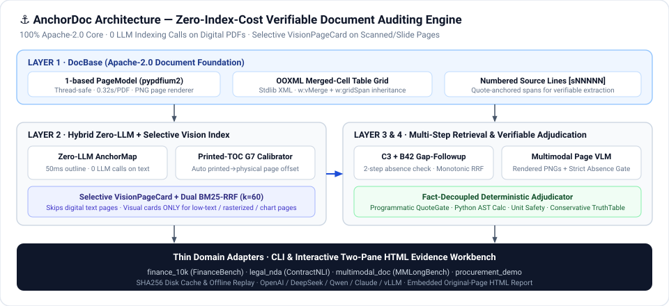
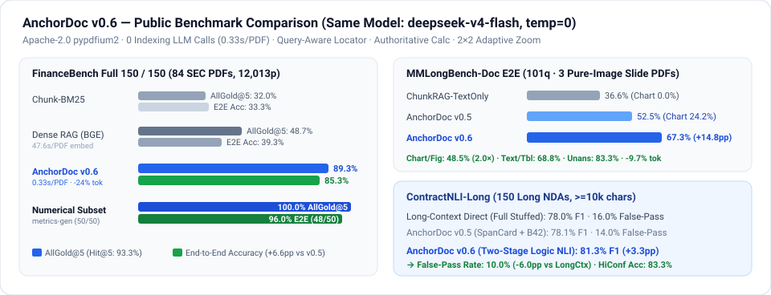

<div align="center">

# ⚓ AnchorDoc

**Let AI Agents Read Long PDFs on Demand — Locate Cross-Page Evidence & Verify Every Claim**

[](LICENSE)
[](pyproject.toml)
[](https://doi.org/10.5281/zenodo.24453581)
[](#independent-claim-verification-verify-any-ai-answer-v093)
[](benchmarks/LEADERBOARD.md)
[](benchmarks/LEADERBOARD.md)
[](benchmarks/LEADERBOARD.md)
[](#mcp-server-for-ai-agents-zero-api-key)

**English** | [简体中文](README_ZH.md)

</div>

---

**AnchorDoc** lets AI agents read long documents on demand to find the exact evidence needed to answer a question. It uses document structure, printed page numbers, and tables to locate relevant passages, keeps digging when evidence is insufficient, and lets every quote and calculation be traced back to the source page.

> **The moment AnchorDoc is built for:** Ask *"Did FY2024 Gross Margin expand vs FY2023 after excluding one-time restructuring charges?"* On Round 1, reading the MD&A (Page 1) and Income Statement (Page 2) shows Reported GAAP Gross Margin rose from `36.0%` to `40.0%` (**`+4.0 pp` — looks like YES**). Instead of stopping there, AnchorDoc's Sufficiency Gate detects an unresolved cross-reference (`See Note 7`) needed to know how much restructuring was booked inside Cost of Goods Sold, issues a targeted Round-2 read of **Page 6 (`Note 7`)**, recomputes Adjusted Gross Margin across Page 2 + Page 6 cells (`46.0% → 41.0%`), and **flips the answer to NO (`-5.0 pp` contraction)** — or, if `Note 7` is removed from the PDF, explicitly returns `PARTIALLY_VERIFIED` (`GAAP +4.0 pp verified; adjusted margin has INSUFFICIENT_EVIDENCE`).

### Try That Exact Moment in 10 Seconds (Clean Clone, 0 Downloads, 0 API Keys)

```bash
git clone https://github.com/ryanvii/AnchorDoc.git && cd AnchorDoc
pip install -e .
python3 examples/quickstart_verify.py
```

Runs both live cases back-to-back with real `time.perf_counter()` timing, zero hardcoded page numbers, and zero hardcoded operands:
- **Run A (Complete 6-page filing with Note 7 on Page 6)**: Round 1 hits `[1, 2]` (`GAAP +4.0 pp`) → detects unresolved `Note 7` → Round 2 reads `[6]` → binds 6 cross-page cells (`p2:L03`, `p2:L04`, `p6:L05`) → flips answer to **`-5.0 pp` (`VERIFIED`)**.
- **Run B (Same filing with Note 7 removed)**: Round 2 searches unread pages, finds no Note 7, refuses to guess → **`PARTIALLY_VERIFIED`** (`INSUFFICIENT_EVIDENCE`).


> **Full 1080p HD Launch Demos**: [English 1080p MP4](https://github.com/ryanvii/AnchorDoc/releases/download/v0.9.1/anchordoc_launch_en.mp4) · [中文 1080p MP4](https://github.com/ryanvii/AnchorDoc/releases/download/v0.9.1/anchordoc_launch_zh.mp4)



---

## Why AnchorDoc?

| Approach | Indexing Cost (250p PDF) | FinanceBench 150/150 E2E* | Multi-Page Recall (AllGold@5) | MMLongBench-Doc (101q) |
|---|---:|---:|---:|---|
| Flat Chunk BM25 | `0.3s` · `0` LLM calls | `33.3%` | `32.0%` | `36.6%` (`0.0%` Chart/Fig) |
| Dense Vector RAG (`BGE-small` ONNX) | `47.6s` (neural embed) | `39.3%` | `48.7%` | Blind to pure-image slides |
| LLM Tree-Index (PageIndex-style 12p win) | `11.4s` · `19.2` calls · `33k` tok | `35.9%` *(39q subset)* | `43.6%` *(39q subset)* | Requires VLM per page |
| **⚓ AnchorDoc (`v0.9.3`)** | **`0.33s` · `0` LLM calls** *(warm `3.9ms`)* | **`85.3%`** *(`96.0%` metrics · `84.7%` auto)* | **`89.3%`** *(`100%` metrics)* | **`68.3%`** *(`54.5%` Chart/Fig)* |

*\*Unified base model (`deepseek-v4-flash`, `temperature=0`, Apache-2.0 `pypdfium2`). Retrieval/adjudication benchmarks reflect frozen milestone runs preserved backward-compatibly in `v0.9.x`, while `v0.9.0–v0.9.3` add zero-API-key claim verification and cross-reference sufficiency detection; complete ablations and cross-model (`DeepSeek-V4.1-Flash`) tables are in [benchmarks/LEADERBOARD.md](benchmarks/LEADERBOARD.md).*

---

## Independent Claim Verification: Verify ANY AI Answer (`v0.9.3`, Zero API Key)

Already using **RAG, PageIndex, or long-context LLMs**? Pass any PDF plus an external claim (quotes, operands bound to row/period/unit, and symbolic or numeric formula) to AnchorDoc **before signing off**. Every report states explicitly **what was verified** (`checks: {quotes, operands, computation, claim_alignment}` + `verified_scope`) with a 4-state verdict (`VERIFIED` | `PARTIALLY_VERIFIED` | `FAILED` | `UNVERIFIED`):

- **`QUOTE_SIGN_FLIP` / `SIGN_FLIP`**: `-12%` vs `12%`, accounting parentheses `$(145)` vs `$145` (even when `+12%` exists elsewhere on the same page)
- **`PERIOD_MISMATCH` / `CLAIM_PERIOD_MISMATCH`**: catches both cell-level column swaps (`378` is `FY2023` while claiming `FY2024`) and claim-level period swaps (valid `FY2024` operands & math `480`, but claim text mislabels it as `FY2023`)
- **`CLAIM_METRIC_MISMATCH`**: keeps `computation="verified"` while failing `claim_alignment` when valid `rev - cogs = 480` (Gross Profit) is mislabeled in `claim_text` as another statement row such as `Net Income` (actual `Net Income = 125` on the same page)
- **`UNIT_SCALE_MISMATCH`**: `in millions` vs `billions` confusion (while passing valid `$1,200M == $1.2B` conversions)
- **`PP_VS_PCT_CONFUSION`**: AST-aware check distinguishing single relative growth (`(a-b)/b*100` → `%`) from differences of two rates/ratios (`(gp24/rev24*100) - (gp23/rev23*100)` → `pp`)
- **`FORMULA_OPERAND_UNBOUND`** (anti-laundering): supports symbolic formulas (`rev - cogs`) and rejects **any** unbound variable or numeric literal — including mixed formulas like `rev - 700` where valid `rev=1200, cogs=720` operands were attached
- **`CLAIM_UNSUPPORTED_BY_EVIDENCE` / `CLAIM_ENTAILMENT_NOT_CHECKED`** (scoped honesty): in quote-only mode, a verbatim quote confirms the quote itself (`quotes=verified`), **never** the whole free-text claim — blocking both irrelevant quotes and same-number metric swaps (e.g. `"FY2024 Gross Margin is 65.0%"` + `"Debt-to-Asset <= 65.0%"`) from receiving `VERIFIED`

### Run the Clean-Clone Synthetic Regression Suite in 1 Second (0 Downloads, 0 API Keys)

```bash
python3 benchmarks/run_adversarial_verify.py
```

| Verifier (33 Synthetic Cases: 22 Adversarial Traps + 11 Valid Claims) | Non-Verified Traps (↑) | Verdict Split on Traps | False-Pass (↓) | False-Alarm (↓) | Exact Diagnosis |
|---|---:|---|---:|---:|---:|
| Naive Alphanumeric Citation & Loose Number Check | `27.3%` (6/22) | `6 FAILED` | `72.7%` (16/22) | `9.1%` (1/11) | — |
| **⚓ AnchorDoc `v0.9.3` (`verify_claim` / `doc_verify`)** | **`22 / 22`** | **`20 FAILED` + `2 PARTIALLY_VERIFIED`** | **`0 / 22`** | **`0 / 11`** | **`22 / 22`** |

*\*Note: This 33-case suite is a deterministic synthetic regression benchmark covering specific known failure classes (sign flip, year swap, unit swap, pp-vs-%, formula laundering, metric swap); it verifies those regressions cleanly rather than estimating a statistical false-pass rate on arbitrary unseen filings.*

```bash
# Verify any external AI claim with cell-bound symbolic formula (exit 0 = VERIFIED, exit 2 = FAILED / PARTIAL)
anchordoc verify-claim report.pdf \
  --claim "FY2024 Gross profit is 480 million." \
  --operands-json '[{"name":"rev","value":1200,"unit":"million","row_label":"Total Revenue","period":"FY2024","page":2},{"name":"cogs","value":720,"unit":"million","row_label":"Cost of Goods Sold","period":"FY2024","page":2}]' \
  --formula "rev - cogs" --claimed-value 480 --claimed-unit "million"
```



---

## Verified Public Benchmarks (401 Official Questions Across 3 Modalities)

- **FinanceBench (Full Official 150 / 150, 84 SEC PDFs, 12,013 pages)**
  - **Indexing**: **27.6s total (`0.33s/PDF`), `0` LLM calls** (145× faster than CPU Dense BGE embedding, 91× faster than upfront LLM tree indexing).
  - **Retrieval (`v0.6` Query-Aware Locator)**: **93.3% Hit@5 / 89.3% AllGold@5** (`+8.6pp` / `+8.0pp` over `v0.5`, MRR `0.8008`) vs Dense BGE **58.0% / 48.7%** and Chunk-BM25 **35.3% / 32.0%**, while cutting query prompt tokens by **23.8%** (`14,150 → 10,780`) and LLM calls by **22.4%** (`5.35 → 4.15`).
  - **End-to-End QA**: **85.3% overall** (`+6.6pp` over `v0.5`, paired McNemar $p=0.0129$; **2.17×** Dense BGE `39.3%`). On all 50 hard numerical statement questions (`metrics-generated`), AnchorDoc achieves **100.0% AllGold@5** and **96.0% E2E accuracy (48/50)** via reasoning-first extraction + authoritative Python AST arithmetic (`safe_calc`, `100%` operand provenance). Replicated on official **`DeepSeek-V4.1-Flash`**: **92.0% Hit@5 / 82.7% E2E** (`92.0%` metrics, `101/101` operands grounded).
- **MMLongBench-Doc (NeurIPS 2024 — 101 questions, 7 non-financial multimodal PDFs incl. 3 pure-image slide decks)**
  - **Selective `VisionPageCard`** skips 100% of text-rich digital pages (`78/170`) and indexes only low-text/scanned pages (`92/170`).
  - **End-to-End (`v0.7` `full_pool` + Tri-State Gate + 2×2 High-Res Zoom)**: **68.3% overall** (`+15.8pp` over `v0.5`, vs `36.6%` ChunkRAG), **54.5%** Chart/Figure (**2.25×** `v0.5`'s `24.2%`), **65.6%** Text/Table, and **83.3%** Unanswerable Abstain accuracy (hallucination cut to `16.7%`).
  - **Unseen Blind Generalization (`v0.6.0`, 10 unseen PDFs, 492 pages, 91q incl. 52 Chart/Figure)**: **91.0% Hit@5**, **50.0% Chart/Figure** (vs `1.9%` ChunkRAG), **50.5% overall** (`+19.7pp` over ChunkRAG).
- **ContractNLI-Long (EMNLP — 150 long legal NDAs `>= 10k` chars, balanced 50/50/50)**
  - **Two-Stage Logic NLI + Adaptive `ReadAll` Router**: **81.3% Accuracy / 81.3% Macro-F1** (`10.0%` FER on `test-150`); on the strictly unseen held-out `dev-150` split (34 unseen contracts), `v0.7` `route=auto` maintains statistical parity in accuracy (`79.3%` vs `78.0%`, Macro-F1 `79.5%` vs `77.9%`) while cutting LLM calls by **41%** (`~3.0 → 1.77 calls/q`).
- **Persistent SQLite WAL `BundleStore` & Prefix-Stable `nav` Caching (`v0.8.0`)**
  - Reloads all **84 SEC PDFs (12,013 pages)** in **`0.330s`** vs `22.13s` cold parse (**`67.1×` faster**, `3.9 ms/PDF`), and persists expensive `VisionPageCard` summaries for `0`-LLM / `0`-render reloads.
  - **T7 3-Run Live Variance & Prefix KV Cache** (30 stratified FinanceBench questions across 5 multi-question SEC 10-Ks on official `DeepSeek-V4.1-Flash`, `temp=0`): **`85.55% ± 3.85%`** E2E Acc, **`100.0% ± 0.0%`** Quote Verified (90/90), **`54.7% ± 10.7%`** real server-side KV prefix cache hit rate (rising to **`65.1%`** warm via prefix-stable `anchordoc_nav`), and **`83.33% ± 0.00%`** deterministic SHA-cached offline replay.

> **Version Reproducibility Note**: `v0.6`, `v0.7`, and `v0.7.1` denote the frozen milestone runs for each benchmark suite above; **`v0.8.0`** preserves the exact retrieval/adjudication core backward-compatibly while adding `BundleStore`, prefix-stable `nav` KV caching, and the 4-tool MCP server (verified on `v0.8.0` live T7 replay at `85.55% ± 3.85%` E2E and `100.0%` quote verification).

See [benchmarks/LEADERBOARD.md](benchmarks/LEADERBOARD.md) for complete tables, ablations, cost-amortization notes, and one-command reproduction scripts.

---

## 60-Second Quickstart

```bash
git clone https://github.com/ryanvii/AnchorDoc.git
cd AnchorDoc
pip install -e .

# 1. Zero-LLM structural inspection (NO API key required — runs in ~0.2s!)
anchordoc outline annual_report_10k.pdf

# 2. Verifiable numerical/compliance QA + interactive two-pane HTML report (with embedded original PDF pages!)
export ANCHORDOC_LLM_BASE=https://api.openai.com/v1
export ANCHORDOC_LLM_MODEL=gpt-4o-mini
export ANCHORDOC_LLM_KEY=sk-...

anchordoc query annual_report_10k.pdf \
  "What is FY2023 gross profit margin?" \
  --html report.html

# 3. Audit a PDF against a JSON checklist (add --vision for scanned/chart PDFs)
anchordoc audit submission.pdf \
  --checklist examples/sample_checklist.json \
  --html audit_workbench.html
```

### Python SDK (5 Lines)

```python
from anchordoc import AnchorRetriever, CachedLLM, FactAdjudicator, PdfDocument, export_html

doc = PdfDocument.from_pdf("annual_report_10k.pdf")          # Apache-2.0 pypdfium2
llm = CachedLLM(cache_dir="./cache")                         # SHA256 cache + OFFLINE replay
hit = AnchorRetriever(doc, llm=llm).retrieve("FY2023 gross margin?", top_k=5)
verdict = FactAdjudicator(llm=llm).answer_numerical(doc, "FY2023 gross margin?", hit.pages)
export_html([verdict], "report.html", doc=doc)               # Standalone two-pane HTML workbench
```

---

## MCP Server for AI Agents (Zero API Key)

Give **Claude Code, Cursor, Windsurf, Antigravity, or Devin** progressive, token-bounded, verifiable access to 500-page PDFs with **zero external LLM calls** (the host agent *is* the LLM — AnchorDoc acts as its zero-LLM index, token guardrail, and deterministic verifier):

### Same-Agent Benchmark: Native Full-PDF vs AnchorDoc Zero-LLM MCP (`DeepSeek-V4.1-Flash`, `temp=0`, 15 SEC 10-K/10-Q filings, avg 144.7p)

| Same Agent (`DeepSeek-V4.1-Flash`) | E2E Acc | Metrics / Novel | Quote Verified | Avg Prompt Tokens | Newly Billed Uncached Tokens |
|---|---:|---:|---:|---:|---:|
| Native Full-PDF Stuffing *(450k-char cap)* | `60.0%` | `80% / 60%` | `53.3%` | `90,824` | `72,827` |
| **⚓ Same Agent + AnchorDoc MCP** *(`0` server LLM calls)* | **`86.7%` (+26.7pp)** | **`100% / 100%`** | **`100.0%` (15/15)** | **`28,188` (-69.0%)** | **`5,430` (-92.5%, 13.4× cheaper)** |

*(Even on the 8 completely untruncated PDFs where 100% of text fit in Native Full-PDF, AnchorDoc MCP still won **`87.5%` vs `50.0%`** by preventing long-context attention decay.)*

### 1-Minute MCP Setup (Claude Code / Cursor / Windsurf / Devin)

```bash
git clone https://github.com/ryanvii/AnchorDoc.git
cd AnchorDoc
pip install -e '.[mcp]'
```

Add to your `mcp.json` (Cursor `.cursor/mcp.json`, Claude Desktop/Code `claude_desktop_config.json`, or Windsurf/Devin MCP config):

```json
{
  "mcpServers": {
    "anchordoc": {
      "command": "anchordoc",
      "args": ["mcp", "--root", "/path/to/your/pdfs"]
    }
  }
}
```

Exposes 4 orthogonal, read-only tools with strict `--root` allowlisting and hard token caps:
- `doc_outline` (L0 map, ≤1.5k tok): structure, printed page range, and `route_hint`.
- `doc_locate` (L1 zero-LLM locator, ≤1.2k tok): lexical BM25-RRF + page-ref + continuation snippets.
- `doc_read` (L2 anchored reader, ≤5 pages): stable `p12:L07` anchors + session duplicate-read ledger + native MCP `ImageContent`.
- `doc_verify`: deterministic quote verification, page localization, AST math (`safe_calc`), and operand provenance.

### Progressive Context Engineering Ecosystem (Documents + Videos)

AnchorDoc shares the exact same **zero-vector, zero-server-LLM, token-budgeted progressive disclosure protocol** with our companion video context MCP server:

| Modality | Repository | Progressive Protocol (`L0 → L1 → L2 → Verify`) | Dependencies |
|---|---|---|---|
| **Long PDFs & Filings** | **⚓ [AnchorDoc](https://github.com/ryanvii/AnchorDoc)** *(this repo)* | `doc_outline` → `doc_locate` → `doc_read` → `doc_verify` | Pure Python + Apache-2.0 `pypdfium2` |
| **Long Videos & Demos** | **🎬 [vidctx-mcp](https://github.com/ryanvii/vidctx-mcp)** | `peek_video_map` → `search_video_moments` → `inspect_frame_range` | `yt-dlp` / `ffmpeg` / `RapidOCR` |

---

## Core Modules & Domain Adapters

- `anchordoc/docbase`: Thread-safe Apache-2.0 1-based `PageModel` (`pypdfium2`) + `PageLabels` + 2×2 high-res tile rendering + stdlib OOXML merged-cell table grid (`w:vMerge` / `w:gridSpan` inheritance, zero false-blanks).
- `anchordoc/store`: Per-document stdlib SQLite WAL `BundleStore` (layered `doc_sha256` / `extractor_fp` / `vision_fp` invalidation, **67× faster** warm reload, zero-render `VisionPageCard` reuse).
- `anchordoc/context.py` & `anchordoc/mcp_server.py`: Zero-LLM progressive `DocContext` API and 4-tool stdio MCP server.
- `anchordoc/index`: `Zero-LLM AnchorMap`, Printed-TOC (`G7`) offset calibrator & soft demotion, printed-page/slide reference resolver, `SelectiveVisionIndexer` (`VisionPageCard`), and `SpanCardIndex`.
- `anchordoc/retrieve`: Cost-derived 3-tier adaptive router (`read_all` | `full_pool` | `navigate`) + Query-Aware Single-Shot Locator (`_pack_snippets`) + continuation-table expansion + conditional decorrelated `B42` gap-followup + full `RetrievalTrace`.
- `anchordoc/extract`: Line-anchored `[sNNNNN]` requirement extraction with automatic verbatim quote-repair loop.
- `anchordoc/adjudicate`: Reasoning-first verifiable adjudicator with deterministic `AnswerContract`, authoritative Python AST arithmetic (`safe_calc`), Grounding Scope Guard, tri-state visual evidence gate (`stated | derivable | absent`), and deterministic truth tables (`decide_compliance`, `decide_nli`).
- `anchordoc/report`: JSON, Markdown, and zero-server interactive two-pane HTML trace workbench with embedded original PDF page previews.
- `adapters/`: Thin domain plugins — `finance_10k`, `legal_nda`, `multimodal_doc`, `procurement_demo`.

---

## Roadmap: Evidence Sufficiency (`v1.0`)

Beyond zero-index retrieval and deterministic claim verification, AnchorDoc's long-term north-star research problem is **Evidence Sufficiency**:

> *How does a long-document system know when the context it retrieved is truly sufficient to answer — and when it must read one more page before committing?*

- **Current (`v0.9.3`)**: Zero-LLM AnchorMap, continuation-table expansion, conditional gap-followup (`B42`), zero-LLM cross-reference gap detection (`detect_unresolved_references`), tri-state visual gate (`stated | derivable | absent`), and cell-bound verification (`VERIFIED | PARTIALLY_VERIFIED | FAILED | UNVERIFIED`).
- **Next (`v1.0`)**: Closed-loop **sufficiency-driven reading** across arbitrary 100–600 page filings — unifying cross-reference gaps, missing comparative periods, and undefined adjusted-metric footnotes directly inside the core retriever + MCP tool loop.

---

## Citation

If you use AnchorDoc or its reproducible benchmarks in your work, please cite via [CITATION.cff](CITATION.cff):

```bibtex
@software{wu2026anchordoc,
  author  = {Wu, HuiYang},
  title   = {AnchorDoc: Zero-Index-Cost Long-Document Context Engineering with Falsifiable Evidence Chains},
  year    = {2026},
  version = {0.9.3},
  doi     = {10.5281/zenodo.24453581},
  url     = {https://github.com/ryanvii/AnchorDoc},
  license = {Apache-2.0}
}
```
