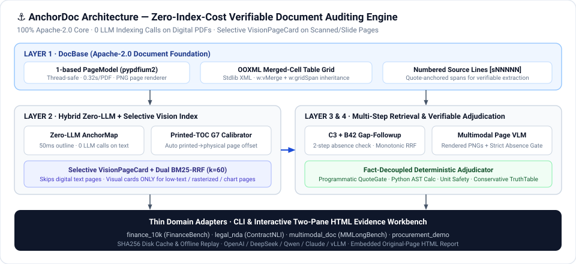
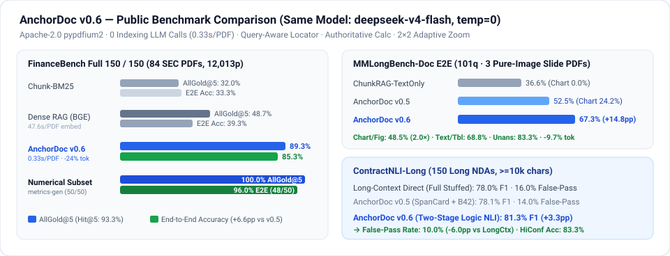

<div align="center">

# ⚓ AnchorDoc

**面向 100–600 页高风险长文档的零建索引成本、无向量可核验审计引擎**

[](LICENSE)
[](pyproject.toml)
[](benchmarks/LEADERBOARD.md)
[](benchmarks/LEADERBOARD.md)
[](benchmarks/LEADERBOARD.md)

[English](README.md) | **简体中文**

</div>

---

**AnchorDoc** 摒弃脆弱的固定切块向量 RAG 与昂贵的全书 LLM 预建树，采用 **“0.3s 零 LLM 全文结构锚点图（AnchorMap） + 单次查询感知定位器（Query-Aware Locator） + 选择性视觉页卡与 2×2 高分放大 + 推理优先确定性裁决（Python 权威验算 / 操作数溯源 / 三值视觉门禁 / 两阶段逻辑 NLI）”** 架构，以纯 Apache-2.0 内核实现高准确率、零建索引维护成本与页级可证伪溯源。



---

## 核心对比（统一底座 `deepseek-v4-flash`, `temperature=0`, Apache-2.0 `pypdfium2`）

| 方案 | 建索引成本（250 页 PDF） | FinanceBench 全量 150 题 E2E | 多页证据找全 (AllGold@5) | MMLongBench-Doc (101 题) |
|---|---:|---:|---:|---|
| 传统平铺切块 BM25 | `0.3s` · `0` 次 LLM | `33.3%` | `32.0%` | `36.6%`（图表 `0.0%`） |
| Dense 向量 RAG（`BGE-small` ONNX） | `47.6s`（向量推理） | `39.3%` | `48.7%` | 纯图 PPT 不可读 |
| LLM 预建树（PageIndex 风格 12 页窗口） | `11.4s` · `19.2` 次 · `33k` tok | `35.9%` *（39 题子集）* | `43.6%` *（39 题子集）* | 需逐页调 VLM |
| AnchorDoc `v0.5` | `0.32s` · `0` 次 LLM | `78.7%`（数值表 `90.0%`） | `81.3%`（数值表 `100%`） | `52.5%`（图表 `24.2%`） |
| **⚓ AnchorDoc `v0.6`** | **`0.33s` · `0` 次 LLM** | **`85.3%`（数值表 `96.0%`）** | **`89.3%`（数值表 `100%`）** | **`67.3%`（图表 `48.5%`，翻倍）** |



---

## 三大国际公开基准实测（401 道官方题，全量可复现）

1. **FinanceBench 官方全量 150 / 150（84 份真实 SEC 年报/季报，12,013 页）**
   - 建索引耗时 **27.6 秒（`0.33s/份`），0 次 LLM 调用**（比 CPU Dense BGE 快 **145 倍**，比 LLM 预建树快 **91 倍**）；
   - **`v0.6` 单次查询感知定位器**：页级召回跃升至 **Hit@5 `93.3%`（+8.6pp）/ AllGold@5 `89.3%`（+8.0pp）**（Dense BGE 仅 `58.0% / 48.7%`），同时单题 Prompt Token 下降 **23.8%**（`14,150 → 10,780`）、调用次数下降 **22.4%**（`5.35 → 4.15`）；
   - 端到端准确率 **`85.3%`**（**+6.6pp**，为 Dense BGE `39.3%` 的 **2.17 倍**）；全部 50 道硬数值报表题 **`100.0%` 找全 / `96.0%`（48/50）端到端准确**。
2. **MMLongBench-Doc（NeurIPS 2024，7 份非金融多模态 PDF 含 3 份 0 字纯图 PPT，101 题）**
   - **`SelectiveVisionIndexer`** 自动跳过全部 78 页文字页（0 成本）、仅对 92 页低字数/纯图页建视觉页卡；模型实际读到的 Top-5 页命中率达 **`93.8%`**（`AllGold@5` **`86.2%`**，**+10.8pp**）；
   - **`v0.6` 三值证据门禁 + 2×2 高分放大**：端到端总准 **`67.3%`**（**+14.8pp**，ChunkRAG 仅 `36.6%`），文本表格 **`68.8%`**（+15.7pp），图表问答 **`48.5%`**（较 v0.5 `24.2%` **直接翻倍**），不可回答题拒答准确率 **`83.3%`**（幻觉率降至 `16.7%`），且平均 Token 反降 **9.7%**（`9,603 → 8,669`）。
3. **ContractNLI-Long（150 条 ≥1 万字长法律合同，三态均衡 50/50/50）**
   - **`v0.6` 两阶段逻辑 NLI + SpanCard 召回修复**：准确率与 Macro-F1 双双升至 **`81.3%`**（**+3.3pp**，明显超越“整本硬塞 Long-Context”的 `78.0%`），高置信度准确率 **`83.3%`**，误通过率（FER）降至 **`10.0%`**（比整本硬塞低 **6.0pp**）。

完整榜单、消融实验、成本摊销分析与复现脚本见 [benchmarks/LEADERBOARD.md](benchmarks/LEADERBOARD.md)。

---

## 60 秒快速上手

```bash
git clone https://github.com/ryanvii/AnchorDoc.git
cd AnchorDoc
pip install -e .

# 1. 无需任何 API Key：0.2 秒查看全文结构锚点图与印刷目录页码偏移
anchordoc outline annual_report_10k.pdf

# 2. 端到端可核验问答 + 一键导出“左结论、右原页截图”双栏单文件 HTML 报告
export ANCHORDOC_LLM_BASE=https://api.openai.com/v1
export ANCHORDOC_LLM_MODEL=gpt-4o-mini
export ANCHORDOC_LLM_KEY=sk-...

anchordoc query annual_report_10k.pdf "What is FY2023 gross profit margin?" --html report.html

# 3. 按 JSON 清单审计长 PDF（扫描件/纯图 PDF 加 --vision）
anchordoc audit submission.pdf --checklist examples/sample_checklist.json --html audit_workbench.html
```

---

## 开源协议与引用

本项目采用商业友好的 **Apache-2.0** 协议（主包零 AGPL 强依赖）。如果本项目对你的研究或工程有帮助，欢迎通过 [CITATION.cff](CITATION.cff) 引用。
